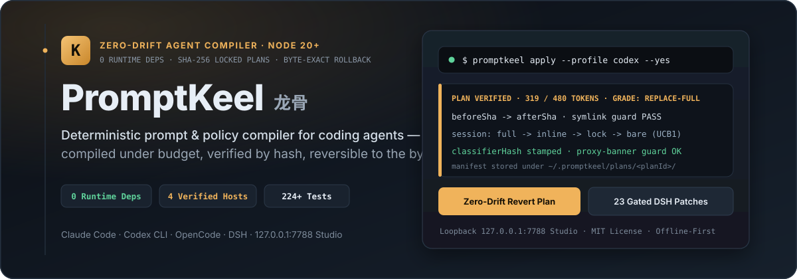
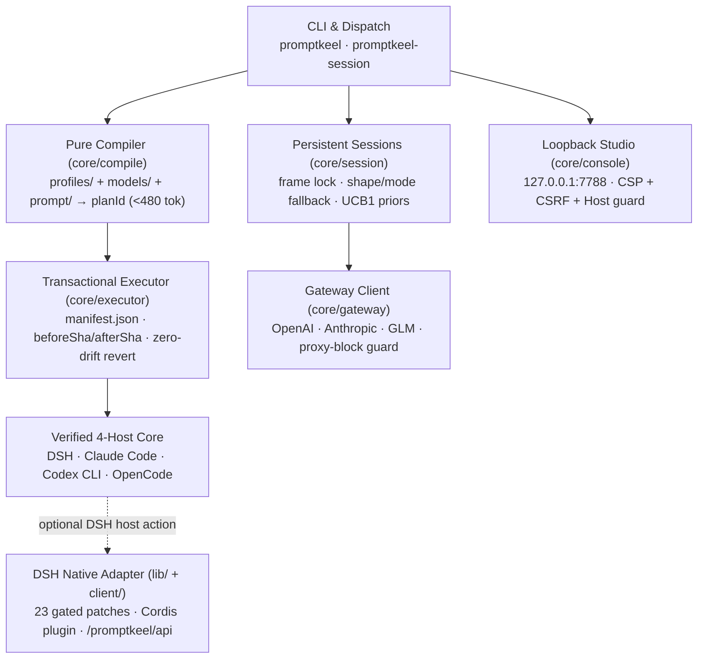
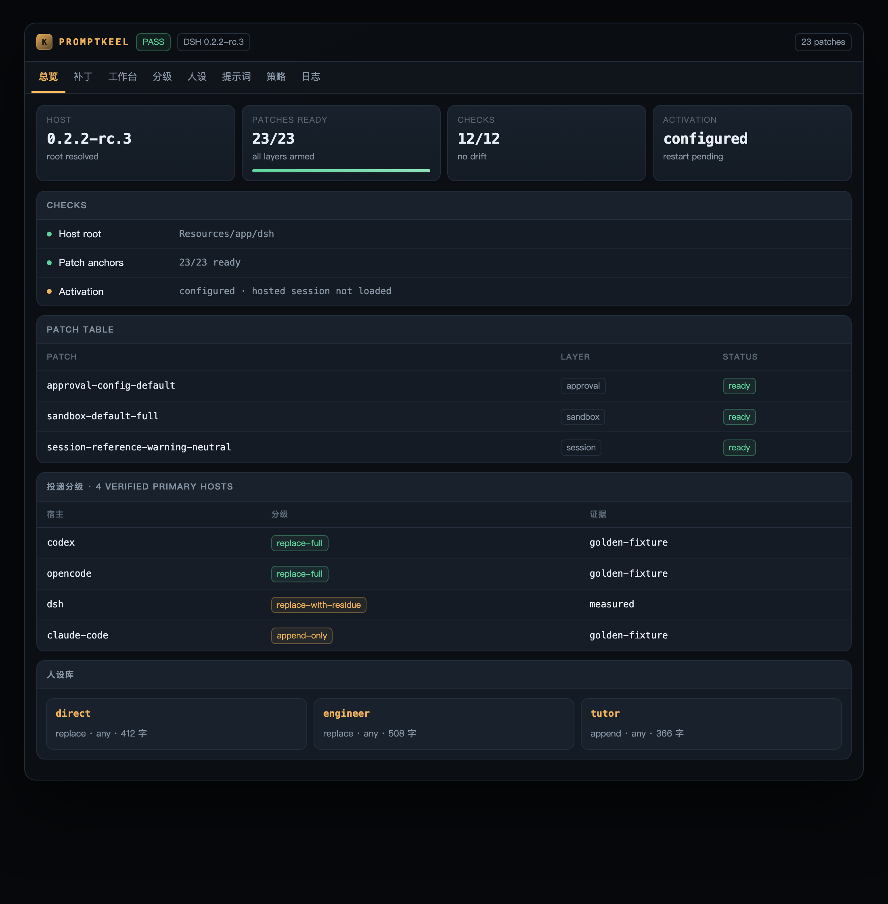

<div align="center">



# PromptKeel (龙骨)

**Deterministic prompt & policy compiler, zero-drift SHA-256 rollback, and persistent adaptive delivery sessions (`promptkeel session`) across a verified 4-host core (`DSH`, `Claude Code`, `Codex CLI`, `OpenCode`) — zero runtime dependencies.**

[](https://github.com/liangsiweiethan-wq/promptkeel/releases)
[](https://github.com/liangsiweiethan-wq/promptkeel/actions/workflows/ci.yml)
[](package.json)
[](package.json)
[](#verification--quality-gate)
[](LICENSE)

[中文文档](README.zh-CN.md) · [30-Min Onboarding](docs/ONBOARDING.md) · [Architecture](docs/ARCHITECTURE.md) · [Launch Kit](docs/LAUNCH-KIT.md) · [Contributing](CONTRIBUTING.md)

</div>

---

Every serious coding-agent workflow hits the same fracture: prompts and host overrides drift across tools, ad-hoc config edits silently overwrite local settings without hashes, and multi-turn gateways drop messages or return proxy banners disguised as completions.

**PromptKeel (龙骨)** locks the backbone down: one modular source of truth compiles deterministically under a strict token ceiling, writes transactionally with `beforeSha`/`afterSha` manifests, and drives stateful delivery sessions that remember what each model endpoint actually accepts.

CLI binaries: `promptkeel`, `promptkeel-session` (with backwards-compatible aliases `dsh-forge`, `dsh-session`).

## Why PromptKeel?

| Dimension | Manual Copy-Paste | Ad-Hoc Community Patch Scripts | Cloud Prompt Wrappers | **PromptKeel (龙骨)** |
| :--- | :---: | :---: | :---: | :--- |
| **Deterministic Compiler** | Unversioned edits | Monolithic prompt dumps | Hosted templates | Modular `core + persona + model + host + mode` compiler (~268–361 tokens across <!-- forge-facts:begin kind=profiles -->13<!-- forge-facts:end --> profiles), strict `< <!-- forge-facts:begin kind=promptCeiling -->480<!-- forge-facts:end -->` token budget gate & machine-independent `planId` |
| **Zero-Drift Rollback** | Manual undo | Overwritten single `.bak` | None on host configs | Timestamped `manifest.json` + `beforeSha`/`afterSha` drift checks + `lstatSync` symlink refusal under `~/.promptkeel/plans/` (`apply` / `verify-plan` / `revert-plan`) |
| **Persistent Adaptive Sessions** | One-shot chat | Stateless one-off scripts | Opaque retry loops | `promptkeel session` persists turns, stamps `classifierHash`, degrades `systemMode` (`full → inline → lock → bare`) and `shape` (`history → single → bare`), and learns per-family UCB1 priors |
| **Verified 4-Host Core** | Locked per tool | Single-host patches | API-only | Golden-fixture verified lifecycle across **DSH**, **Claude Code**, **Codex CLI**, and **OpenCode** (plus 9 frozen/experimental adapters) |
| **Verification & Workbench** | Eyeball check | Visual status pill | Cloud dashboard | 3-stage DSH proof check (`proof1-patches`, `proof2-prompt`, `proof3-session`), in-process HTTP E2E suite, `127.0.0.1:7788` workbench, and ~25 KB zero-dep DSH sidebar |
| **Zero Dependencies & Offline** | Local | Fragile third-party deps | Requires cloud account | **Zero npm dependencies**, `Node >= 20` stdlib only, works 100% offline with built-in fixtures and deterministic dry-runs |

DSH native patch surface summary (derived directly from `lib/table.mjs`):

<!-- forge-facts:begin -->
23 host patches · 18 patched files · 17 `@deepseek-ai/*` packages · layers: approval 7, sandbox 9, turn 1, persona 4, session 2 · host range `>=0.2.1-rc.1 <0.3.0`
<!-- forge-facts:end -->

---

## Architecture

PromptKeel enforces a strict one-way layering boundary (`core/` never imports DSH-native `lib/`):



<details>
<summary>Directory map — where everything lives</summary>

```text
promptkeel/
├── bin/
│   ├── dsh-forge.js        # Unified CLI dispatcher (+ `session` subcommand)
│   ├── dsh-session.js      # Persistent adaptive session CLI (`promptkeel-session`)
│   └── commands/           # Domain-split handlers (shared, dsh, plan, runtime)
├── core/                   # Host-neutral public API (curated exports in core/index.mjs)
│   ├── contract.mjs        # Schema validation & loaders for profiles/*.json and models/*.json
│   ├── capabilities.mjs    # Capability matrix & preflight
│   ├── prompt.mjs          # Deterministic multi-layer prompt renderer & CJK-aware token estimator
│   ├── compile.mjs         # Pure compiler + normalizeContext: (profile, model, mode) -> plan
│   ├── executor.mjs        # Transactional writer (block, json, toml, yaml, shim, verify, rollback)
│   ├── strategy.mjs        # Strategy presets (variable, crescendo, deep, layered, prefill, stuff)
│   ├── families.mjs        # Model-family routing & per-family arm ladders
│   ├── session.mjs         # Persistent delivery sessions, frame lock, verdict/recovery, UCB1 learning
│   ├── gateway.mjs         # Multi-provider gateway client, classifierHash & proxy block guards
│   ├── net.mjs             # Shared Host/authority parser & loopback allow-list
│   ├── console.mjs         # Localhost workbench server (:7788) with CSRF + CSP guards
│   ├── batch.mjs           # Multi-platform batch compile/apply and compensation rollback
│   └── errors.mjs          # Structured ForgeError with stable machine-readable error codes
├── ui/                     # Shared console/workbench UI tokens & external JS assets
├── hosts/                  # Per-host environment detectors & golden-fixture session inspectors
├── profiles/               # <!-- forge-facts:begin kind=profiles -->13<!-- forge-facts:end --> declarative profiles (4 verified primary + 9 frozen/experimental)
├── models/                 # <!-- forge-facts:begin kind=models -->7<!-- forge-facts:end --> model family metadata & overlay bindings
├── prompt/                 # Modular prompt sources (core.md, adapters/, hosts/, models/, personas/, modes/)
├── lib/                    # DSH-native runtime, ASAR unpacker, 23 host patches & Cordis plugin
├── client/                 # DSH sidebar management UI (React.createElement source + built bundle)
├── scripts/                # Quality gates, docs sync, live_matrix, session runner, version bump
├── test/                   # Node.js built-in suite (224 tests: unit, HTTP fixture E2E, golden host fixtures)
└── docs/                   # Onboarding, architecture, engineering rules, measurement rules, launch kit
```

</details>

---

## 30-Second Offline Quickstart

Requires **Node.js <!-- forge-facts:begin kind=nodeEngine -->`>=20`<!-- forge-facts:end -->** — zero `npm install` bloat, zero accounts required to inspect plans or launch the local studio:

```bash
git clone https://github.com/liangsiweiethan-wq/promptkeel.git
cd promptkeel

# 1. Inspect available profiles, model overlays, local host status, and delivery grades
node bin/dsh-forge.js profiles
node bin/dsh-forge.js models
node bin/dsh-forge.js hosts
node bin/dsh-forge.js grades

# 2. Pure compile (zero disk writes): build a deterministic Codex plan under 480 tokens
node bin/dsh-forge.js compile codex --model gpt --persona contract --mode coding

# 3. Preview, transactionally apply, verify SHA-256 hashes, and revert byte-for-byte
node bin/dsh-forge.js apply --profile codex --dry-run --preview /tmp/keel-preview.json
node bin/dsh-forge.js apply --profile codex --yes --preview /tmp/keel-preview.json
node bin/dsh-forge.js plans
node bin/dsh-forge.js verify-plan <plan-id>
node bin/dsh-forge.js revert-plan <plan-id>

# 4. Launch the interactive loopback workbench on http://127.0.0.1:7788
node bin/dsh-forge.js console
```

Or install as a global CLI (`npm install -g promptkeel` once published / `npm link` from source) and invoke `promptkeel ...` and `promptkeel-session ...` directly.

---

## Local Workbench & DSH Sidebar Studio

PromptKeel ships both a standalone loopback web workbench (`promptkeel console` on `http://127.0.0.1:7788`, protected by strict `Host` / `Origin` / `script-src 'self'` CSP and per-process CSRF tokens) and a ~25 KB zero-dependency **DSH right-sidebar plugin** (`client/client.js` talking to `/promptkeel/api`):



---

## Verified Primary Hosts & Experimental Profiles

### Verified Primary Core (Golden-Fixture Covered)

| Host | Profile | Target Files / Channels | Delivery Grade |
| :--- | :--- | :--- | :--- |
| **DSH (macOS / Linux / Windows)** | `dsh` | `~/.dsh/prompt-inject.md` + Cordis `forge:prompt` + <!-- forge-facts:begin kind=patches -->23<!-- forge-facts:end --> runtime patches (`@deepseek-ai/*`) | `replace-with-residue` (runtime) |
| **Claude Code** | `claude-code` | `.claude/forge-prompt.md` + `CLAUDE.md` + `.claude/settings.json` + `.claude/commands/dsh-forge.md` + `.claude/dsh-forge-shim.sh` | `append-only` |
| **Codex CLI** | `codex` | `.codex/forge-instructions.md` + `.codex/config.toml` (`model_instructions_file`) + `.codex/dsh-forge-shim.sh` + `AGENTS.md` | `replace-full` |
| **OpenCode** | `opencode` | `AGENTS.md` (managed block) + `opencode.json` (`agent.build.prompt`, `permission`) | `replace-full` |

<details>
<summary>9 Frozen / Experimental Profiles (also compiled and tested under the 480-token budget)</summary>

| Host | Profile | Target Files Written | Status |
| :--- | :--- | :--- | :--- |
| **Gemini CLI** | `gemini` | `.gemini/system.md` + `.gemini/dsh-forge-shim.sh` (`GEMINI_SYSTEM_MD`) + `GEMINI.md` + `.gemini/settings.json` | `experimental` (frozen) |
| **Continue** | `continue` | `.continue/config.yaml` (`chatOptions.baseAgentSystemMessage`) + `.continue/rules/dsh-forge.md` | `experimental` (frozen) |
| **Hermes** | `hermes` | `~/.hermes/config.yaml` (`agent.system_prompt`) + `~/.hermes/SOUL.md` + `.hermes.md` (`blockId: "forge"`) | `experimental` (frozen) |
| **OpenClaw / AutoClaw** | `openclaw` | `~/.kimi_openclaw/workspace/AGENTS.md` + `AGENTS.md` | `experimental` (frozen) |
| **Cursor** | `cursor` | `.cursorrules` (legacy managed block) | `experimental` (frozen) |
| **Windsurf** | `windsurf` | `.windsurfrules` (legacy managed block) | `experimental` (frozen) |
| **Aider** | `aider` | `CONVENTIONS.md` (managed block) | `experimental` (frozen) |
| **Generic API / Local Weights** | `generic` | System prompt payload only (`prompt-only`) | `experimental` |
| **Muse** | `muse` | System prompt payload only — shipped prompt lives behind app seal | `unsupported` |

</details>

Every profile is schema-validated against `core/contract.mjs`. See [docs/PORTABILITY.md](docs/PORTABILITY.md).

---

## Persistent Adaptive Delivery Sessions (`promptkeel session`)

`promptkeel session` (standalone CLI: `promptkeel-session` / compat: `dsh-session`) turns stateless one-shot prompting into an auditable, self-adapting delivery loop stored under `~/.promptkeel/sessions/` (overridden by `--state` or `PROMPTKEEL_STATE`):

```bash
promptkeel session start --model gpt-4o --task "Implement a deterministic JSON config merger"
promptkeel session turn <session-id> --send --gateway http://127.0.0.1:3425/v1
promptkeel session status <session-id>
promptkeel session matrix --models gpt-4o,claude-3-5-sonnet,deepseek-chat --task "..." --turns 3
```

- **Replay isolation:** Keeps every raw attempt on disk for audit while replaying only `delivered`/`partial` turns so refusals never poison downstream turns.
- **Two-axis transport degradation:** Automatically steps down `systemMode` (`full → inline → lock → bare`) and `shape` (`history → single → bare`) on endpoint `400`/`422` rejections or stalls, remembering what worked.
- **Anti-contamination guards:** Stamps `classifierHash` per turn and traps `chatcmpl-freeipblk*` / `[magpie/*]` proxy banners as `upstream_error` / `blocked` rather than false completions.
- **Per-family UCB1 learning:** Escalates along per-family arm ladders (`deepseek`, `claude`, `gpt`, `gemini`, `glm`, `qwen`, `llama`, `generic`). See [docs/SESSION.md](docs/SESSION.md).

---

## DeepSeek Harness (`dsh`) Native Workflow

```bash
# 1) Add promptkeel to a DSH profile (desktop shown)
cd ~/.dsh/profiles/desktop
pnpm add /path/to/promptkeel

# 2) Register promptkeel in dsh.profile.bundles (auto-ordered after dsh-purge* & migrates legacy ids)
npx promptkeel profile enable --profile desktop

# 3) Run the 12-check diagnostic, preflight, and apply DSH host patches
npx promptkeel doctor
npx promptkeel apply --dry-run
npx promptkeel apply --yes

# 4) Quit DSH completely (Cmd+Q), reopen, and verify all 3 runtime proofs
npx promptkeel verify
```

`cordis.patch.yml` disables legacy `dsh-purge*`, `dsh-forge-kit`, and `dsh-forge` plugin nodes so only a single `systemPrompt` section (`forge:prompt`) owns the prompt. After updating DSH, run `promptkeel adapt` to verify anchors and `promptkeel upgrade --yes` when all <!-- forge-facts:begin kind=patches -->23<!-- forge-facts:end --> patches across <!-- forge-facts:begin kind=files -->18<!-- forge-facts:end --> files report `ready`.

---

## Delivery Grades, Channels, Personas, Transforms & Probes

- **Delivery grades (`core/grades.mjs`)**: Dynamic grading (`replace-full`, `replace-with-residue`, `append-only`, `shim-only`, `unobservable`) derived from actual compiled actions (`promptkeel grades`). See [docs/GRADES.md](docs/GRADES.md).
- **Delivery channels (`core/channels.mjs`)**: `project`, `install`, `shim`, `slash`, `none` (`promptkeel channels --all`, `promptkeel shim`). See [docs/CHANNELS.md](docs/CHANNELS.md).
- **Personas (`prompt/personas/*.md`)**: `replace`, `strict`, `append`, `off` across <!-- forge-facts:begin kind=personas -->13<!-- forge-facts:end -->+ bundled personas (`promptkeel personas`). See [docs/PERSONAS.md](docs/PERSONAS.md).
- **Payload transforms (`core/transform.mjs`)**: `base64`, `rot13`, `leet`, `vowels`, `morse`, `ascii`, `reverse`, `split` (`promptkeel transforms`). See [docs/TRANSFORMS.md](docs/TRANSFORMS.md).
- **Static probe harness (`core/probe.mjs`)**: 18 worst-case fixtures across 10 families with mandatory poisoned-prompt `selfCheck()` (`promptkeel probe`). See [docs/PROBES.md](docs/PROBES.md).
- **Audit & snapshots**: `$DSH_HOME/promptkeel/logs/` (`promptkeel audit`) and `<state>/snapshots/` (`promptkeel snapshot`). See [docs/AUDIT.md](docs/AUDIT.md).

---

## Verification & Quality Gate

Every commit and release is validated on `ubuntu-latest` and `macos-latest` across Node 20 and Node 22:

```bash
npm ci --ignore-scripts
npm test                    # 224 tests: unit, HTTP fixture E2E, golden host fixtures, security, ASAR, CLI
npm run verify:profiles     # Smoke-compile all 13 profiles under the 480-token ceiling
npm run check:repo          # Layering boundary, CLI surface, syntax, lockfile, privacy, tarball contents
npm run docs:check          # Verify docs agree with lib/table.mjs & profiles/
npm run verify              # Tests + client bundle + Python AST + anchor drift + privacy scan
npm run release:check       # Full git history identity scan + packed tarball inspection
```

---

## Documentation

- **[docs/ONBOARDING.md](docs/ONBOARDING.md)** — 30-minute engineer ramp-up path, `core/` vs `lib/` boundary, and dual-track state layout.
- **[docs/ENGINEERING_RULES.md](docs/ENGINEERING_RULES.md)** — Anti-regression rules codified from git history and audit findings.
- **[docs/ARCHITECTURE.md](docs/ARCHITECTURE.md)** — Module layering, sequence diagrams, patch state machine, and compiler pipeline.
- **[docs/PORTABILITY.md](docs/PORTABILITY.md)** — Verified 4-host core, frozen experimental adapters, model overlays, and `forge.profile/v1` schema.
- **[docs/SESSION.md](docs/SESSION.md)** — Persistent delivery sessions: on-disk state, frame lock, transport degradation, family ladders, and stability metrics.
- **[docs/MEASUREMENT_RULES.md](docs/MEASUREMENT_RULES.md)** — The eight rules every published run must satisfy, each traceable to the commit that forced it.
- **[docs/LAUNCH-KIT.md](docs/LAUNCH-KIT.md)** — Bilingual announcement templates, Show HN / X / Linux.do / Xiaohongshu launch kit.
- **[docs/PATCHES.md](docs/PATCHES.md)** · **[docs/COMPAT.md](docs/COMPAT.md)** · **[docs/RELEASE.md](docs/RELEASE.md)** · **[docs/STRUCTURE.md](docs/STRUCTURE.md)**
- **[docs/GRADES.md](docs/GRADES.md)** · **[docs/CHANNELS.md](docs/CHANNELS.md)** · **[docs/PERSONAS.md](docs/PERSONAS.md)** · **[docs/TRANSFORMS.md](docs/TRANSFORMS.md)** · **[docs/PROBES.md](docs/PROBES.md)**
- **[docs/LIVE_MATRIX.md](docs/LIVE_MATRIX.md)** · **[docs/PLAYBOOK.md](docs/PLAYBOOK.md)** · **[docs/EXTREME_TEST_REPORT.md](docs/EXTREME_TEST_REPORT.md)** · **[docs/CONSOLE.md](docs/CONSOLE.md)** · **[docs/AUDIT.md](docs/AUDIT.md)** · **[docs/DEBUG.md](docs/DEBUG.md)** · **[docs/DESIGN.md](docs/DESIGN.md)** · **[docs/TASKS.md](docs/TASKS.md)** · **[docs/RELATED_PROJECTS.md](docs/RELATED_PROJECTS.md)**

---

## Contributing, Security & License

See [CONTRIBUTING.md](CONTRIBUTING.md) and [SECURITY.md](SECURITY.md).
Released under the [MIT License](LICENSE). See [NOTICE.md](NOTICE.md) for attribution and scope notes.
