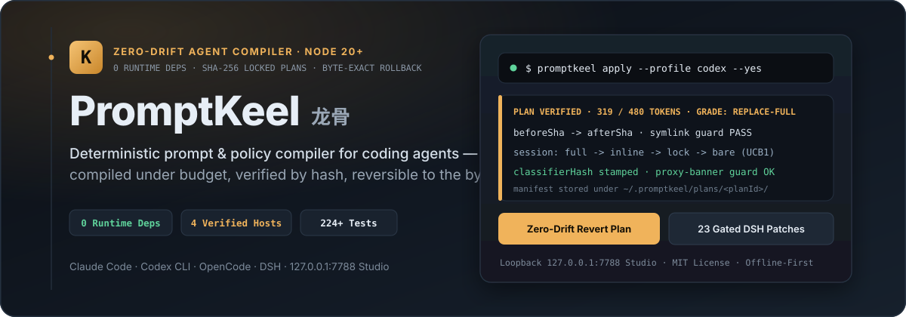
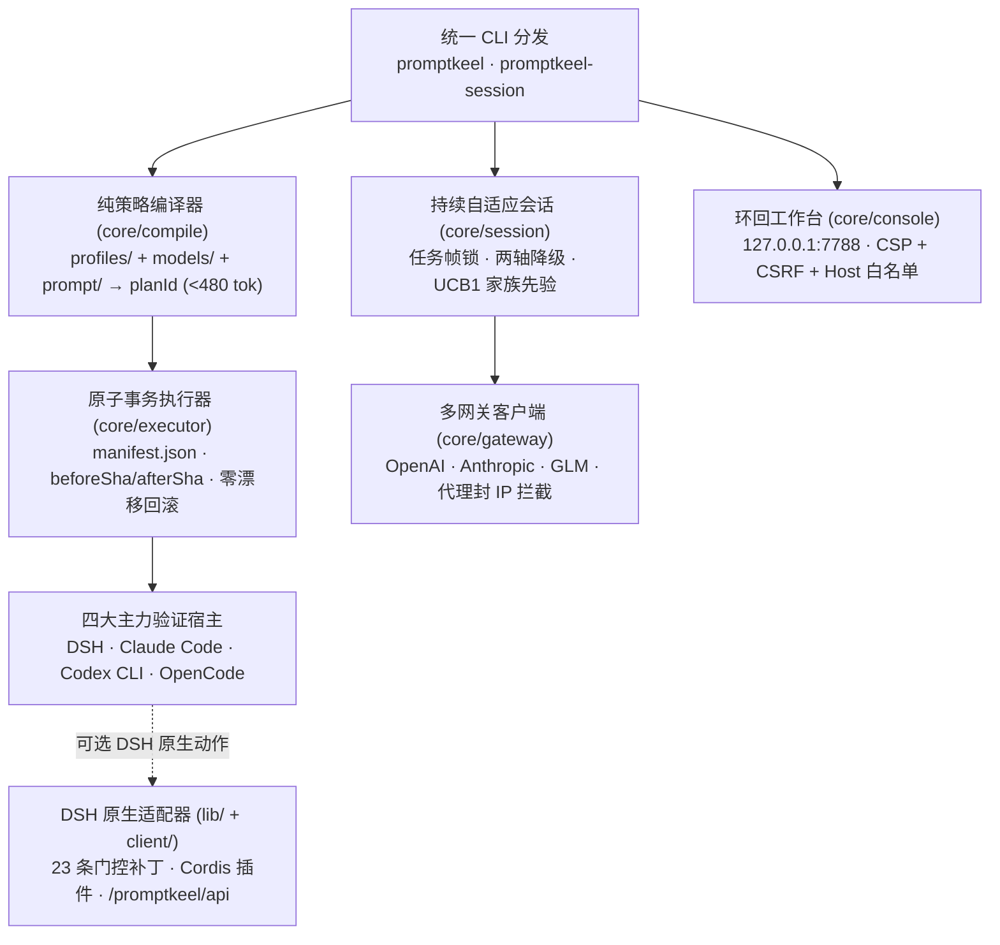
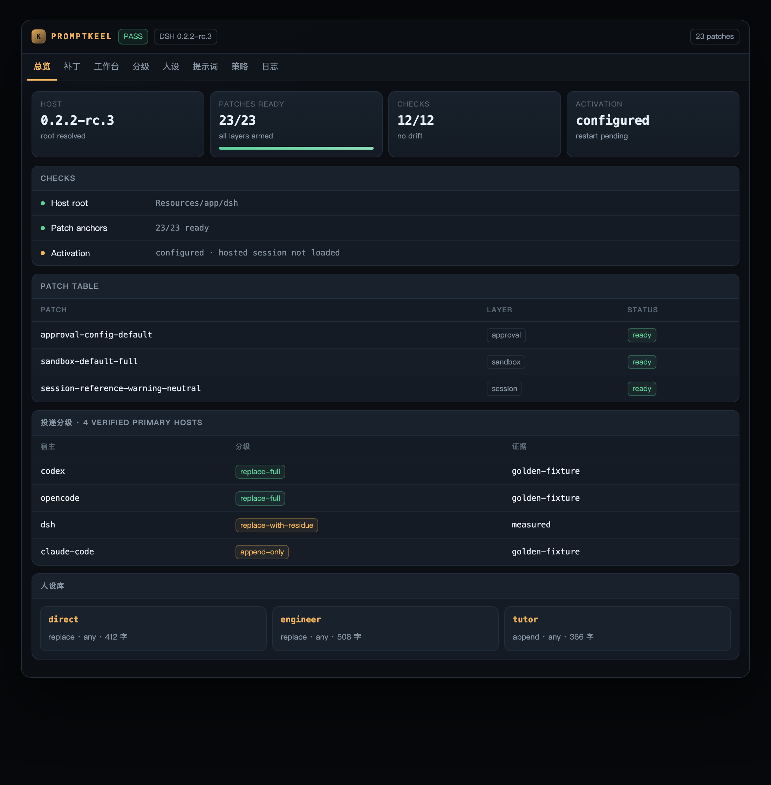

<div align="center">



# PromptKeel（龙骨）

**面向 `DSH` / `Claude Code` / `Codex CLI` / `OpenCode` 四大主力验证宿主的确定性策略编译器、零漂移回滚执行器、持续自适应交付会话（`promptkeel session`）与本地工作台——零第三方运行时依赖。**

[](https://github.com/liangsiweiethan-wq/promptkeel/releases)
[](https://github.com/liangsiweiethan-wq/promptkeel/actions/workflows/ci.yml)
[](package.json)
[](package.json)
[](#验证与质量闸门)
[](LICENSE)

[English](README.md) · [30 分钟上手](docs/ONBOARDING.md) · [架构设计](docs/ARCHITECTURE.md) · [宣发文案包](docs/LAUNCH-KIT.md) · [参与贡献](CONTRIBUTING.md)

</div>

---

在多套 AI 编程宿主间来回切换时，提示词与权限规则极易碎片化：手改配置没有哈希留痕与回滚保障，多轮网关遇到吞槽拒收或代理封 IP 横幅时还常被误判为「正常回复」。

**PromptKeel（龙骨）** 用一根确定性「龙骨」稳住整条交付链路：同一套模块化源码在硬性 token 预算上限内确定性编译，写盘前留存完整原始字节与 `SHA-256` 校验清单，并能在多轮会话中自动降级与跨会话学习各模型家族的最佳投递阶梯。

命令行入口：`promptkeel`、`promptkeel-session`（向下兼容 `dsh-forge`、`dsh-session`）。

## 为什么选择 PromptKeel（龙骨）？

| 维度 | 手动复制粘贴 | 传统散装补丁脚本 | 云端提示词面板 | **PromptKeel（龙骨）** |
| :--- | :---: | :---: | :---: | :--- |
| **确定性策略编译** | 无版本、易漂移 | 硬编码超长提示词或污染全局 | 托管云端模板 | `core + persona + model + host + mode` 模块化拼接（<!-- forge-facts:begin kind=profiles -->13<!-- forge-facts:end --> 份档案约 268–361 token），受控于 `< <!-- forge-facts:begin kind=promptCeiling -->480<!-- forge-facts:end -->` token 硬上限与机器无关 `planId` |
| **零漂移事务回滚** | 全靠手动撤回 | 覆盖单一 `.bak` 文件 | 不管本地宿主文件 | 每次写入在 `~/.promptkeel/plans/` 保留完整原始字节与 `beforeSha`/`afterSha` 清单、`lstatSync` 符号链接拒写校验（`apply` / `verify-plan` / `revert-plan`） |
| **持续自适应会话** | 一次性无状态 | 无历史与错判防护 | 黑盒重试 | `promptkeel session` 落盘每轮记录、戳记 `classifierHash`、自动降级 `systemMode`（`full→inline→lock→bare`）与 `shape`（`history→single→bare`），并积累家族 UCB1 战绩 |
| **四大主力验证宿主** | 单工具散落 | 绑定单一宿主 | 仅限 API 调用 | **DSH**、**Claude Code**、**Codex CLI**、**OpenCode** 均具备黄金探测 fixture 与完整 `compile→apply→verify→revert` 覆盖（另附 9 个冻结/实验档案） |
| **交互式工作台与校验** | 肉眼检查 | 仅状态灯 | 在线后台 | `127.0.0.1:7788` 本地工作台（Strict CSP + CSRF）与约 25 KB 零依赖 DSH 右侧栏；DSH 三阶段实证 + 进程内 HTTP 端到端测试 |
| **零依赖 · 100% 离线** | 本地 | 依赖易碎三方包 | 需要登录云账号 | **零 npm 运行时/开发依赖**，纯 `Node >= 20` 原生标准库，自带离线 fixture 与无写盘预览 |

DSH 原生补丁表面事实（由 `lib/table.mjs` 自动派生）：

<!-- forge-facts:begin -->
23 host patches · 18 patched files · 17 `@deepseek-ai/*` packages · layers: approval 7, sandbox 9, turn 1, persona 4, session 2 · host range `>=0.2.1-rc.1 <0.3.0`
<!-- forge-facts:end -->

---

## 系统架构

PromptKeel 强制执行单向依赖隔离（宿主无关核心 `core/` 严禁 import DSH 原生运行时 `lib/`）：



---

## 30 秒离线快速开始

需要 **Node.js <!-- forge-facts:begin kind=nodeEngine -->`>=20`<!-- forge-facts:end -->**（零第三方运行时依赖，无需任何云端账号即可编译预览、验证回滚、启动工作台）：

```bash
git clone https://github.com/liangsiweiethan-wq/promptkeel.git
cd promptkeel

# 1. 查看所有宿主档案、模型覆盖、本机宿主探测与动态投递分级
node bin/dsh-forge.js profiles
node bin/dsh-forge.js models
node bin/dsh-forge.js hosts
node bin/dsh-forge.js grades

# 2. 纯编译（不写磁盘）：预览 Codex replace-full 计划
node bin/dsh-forge.js compile codex --model gpt --persona contract --mode coding

# 3. 预检、事务应用、校验 SHA-256 并零漂移回滚
node bin/dsh-forge.js apply --profile codex --dry-run --preview /tmp/keel-preview.json
node bin/dsh-forge.js apply --profile codex --yes --preview /tmp/keel-preview.json
node bin/dsh-forge.js plans
node bin/dsh-forge.js verify-plan <plan-id>
node bin/dsh-forge.js revert-plan <plan-id>

# 4. 启动本地环回工作台：http://127.0.0.1:7788
node bin/dsh-forge.js console
```

---

## 本地工作台与 DSH 侧边栏预览

PromptKeel 同时提供独立的环回本地工作室（`127.0.0.1:7788`，严格受 `Host` / `Origin` / `script-src 'self'` CSP 与每进程 CSRF 令牌保护）以及仅约 25 KB 的零依赖 **DSH 右侧栏插件**（`client/client.js`，通信路由 `/promptkeel/api`）：



---

## 四大主力验证宿主与多模型会话

- **已验证主力宿主**：`DSH`、`Claude Code`、`Codex CLI`、`OpenCode`（共 <!-- forge-facts:begin kind=profiles -->13<!-- forge-facts:end --> 份声明式宿主档案与 <!-- forge-facts:begin kind=models -->7<!-- forge-facts:end --> 份模型家族覆盖，完整对照见 [docs/PORTABILITY.md](docs/PORTABILITY.md)）。
- **模块化提示词与人设库**：`prompt/core.md` + <!-- forge-facts:begin kind=personas -->13<!-- forge-facts:end -->+ 份人设（`prompt/personas/*.md`）与模型/模式片段，全量受 `< 480` token 硬上限与 `node scripts/verify-profiles.mjs` 守卫。
- **持续自适应交付会话（`promptkeel session` / `promptkeel-session`）**：会话落盘 `~/.promptkeel/sessions/`，重放层过滤拒答以免毒化上下文，支持 `systemMode`（`full→inline→lock→bare`）与 `shape`（`history→single→bare`）两级降级，识别 `chatcmpl-freeipblk*` / `[magpie/*]` 代理拦截并戳记 `classifierHash`。详见 [docs/SESSION.md](docs/SESSION.md)。

```bash
# 持续会话 CLI 示例
node bin/dsh-session.js start --model gpt-4o --task "实现确定性配置合并器"
node bin/dsh-session.js turn <session-id> --send --gateway http://127.0.0.1:3425/v1
node bin/dsh-session.js status <session-id>
```

### DeepSeek Harness (`dsh`) 原生命令

```bash
cd ~/.dsh/profiles/desktop
pnpm add /path/to/promptkeel

npx promptkeel profile enable --profile desktop   # 自动排序至 dsh-purge* 之后并迁移旧版 ID
npx promptkeel doctor                            # 运行 12 项宿主、版本、锚点、预算与冲突检查
npx promptkeel apply --dry-run                   # 预检 23 条补丁覆盖 18 个 @deepseek-ai/* 文件
npx promptkeel apply --yes                       # 事务写入（必要时安全拆包 app.asar）
npx promptkeel verify                            # 重启 DSH 后校验 3 项运行时实证
```

---

## 验证与质量闸门

每次提交与发布前均在 CI（`ubuntu-latest` / `macos-latest` × Node 20 / 22）跑通全套零妥协门禁：

```bash
npm ci --ignore-scripts
npm test                    # 224 项测试：单元、HTTP fixture 端到端、黄金宿主 fixture、安全与工作台测试
npm run verify:profiles     # 全量 13 份 Profile 480-token 预算与预检验证
npm run check:repo          # 分层边界、CLI 表面、语法、锁文件、隐私与 tarball 内容门禁
npm run docs:check          # 文档同步事实自检
npm run verify              # 全套测试 + 客户端构建 + Python AST + 锚点预检 + 隐私扫描
npm run release:check       # 包含全量 Git 历史身份扫描与打包检查的发布闸门
```

---

## 文档索引

- **[docs/ONBOARDING.md](docs/ONBOARDING.md)** / **[docs/ENGINEERING_RULES.md](docs/ENGINEERING_RULES.md)** — 新人 30 分钟上手路径与防回归工程铁律
- **[docs/ARCHITECTURE.md](docs/ARCHITECTURE.md)** / **[docs/STRUCTURE.md](docs/STRUCTURE.md)** — 模块分层、状态机与目录规范
- **[docs/PORTABILITY.md](docs/PORTABILITY.md)** / **[docs/GRADES.md](docs/GRADES.md)** — 四大主力验证宿主、冻结实验宿主与动态投递分级
- **[docs/PATCHES.md](docs/PATCHES.md)** / **[docs/COMPAT.md](docs/COMPAT.md)** — DSH 原生 <!-- forge-facts:begin kind=patches -->23<!-- forge-facts:end --> 条补丁覆盖 <!-- forge-facts:begin kind=files -->18<!-- forge-facts:end --> 个文件明细与版本兼容范围
- **[docs/LIVE_MATRIX.md](docs/LIVE_MATRIX.md)** / **[docs/PLAYBOOK.md](docs/PLAYBOOK.md)** — API 实测方法、安全边界与逐模型策略读数
- **[docs/SESSION.md](docs/SESSION.md)** — 持续会话：落盘状态、逐轮锁定、传输降级、家族阶梯与稳定性度量
- **[docs/LAUNCH-KIT.md](docs/LAUNCH-KIT.md)** — 中英双语 Release Notes 与多社群首发宣发文案包
- **[docs/MEASUREMENT_RULES.md](docs/MEASUREMENT_RULES.md)** — 发布任何实测数字前必须满足的八条规则，每条都能追到逼出它的那次提交
- **[docs/RELEASE.md](docs/RELEASE.md)** — 发布前的五道门禁、版本切割与 `promptkeel` 更名迁移说明
- **[docs/EXTREME_TEST_REPORT.md](docs/EXTREME_TEST_REPORT.md)** · **[docs/CONSOLE.md](docs/CONSOLE.md)** · **[docs/AUDIT.md](docs/AUDIT.md)** · **[docs/DEBUG.md](docs/DEBUG.md)** · **[docs/DESIGN.md](docs/DESIGN.md)** · **[docs/RELATED_PROJECTS.md](docs/RELATED_PROJECTS.md)** · **[docs/TASKS.md](docs/TASKS.md)**

---

## 贡献、安全与开源许可

见 [CONTRIBUTING.md](CONTRIBUTING.md) 与 [SECURITY.md](SECURITY.md)。
基于 [MIT License](LICENSE) 开源，附加声明见 [NOTICE.md](NOTICE.md)。
