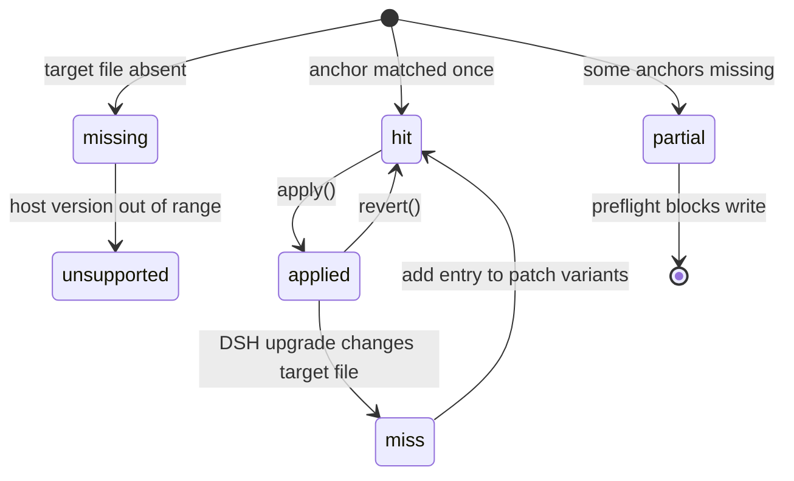
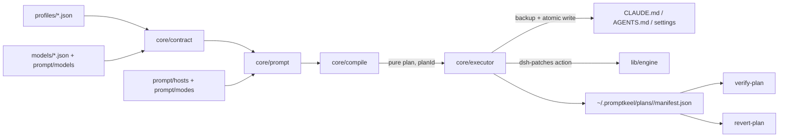
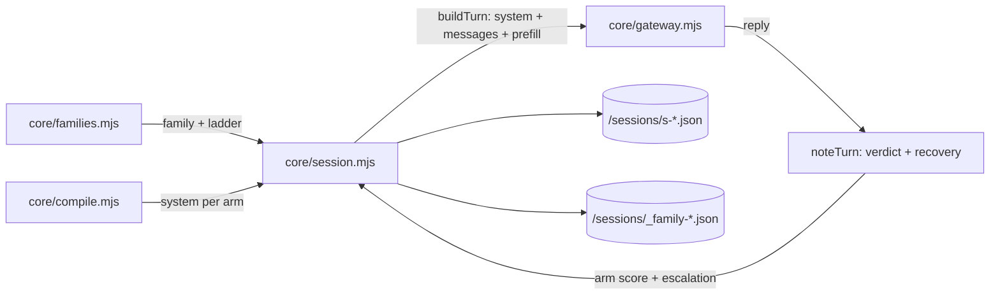

# Architecture

Patch surface facts for this document are generated from `lib/table.mjs`:

<!-- forge-facts:begin -->
23 host patches · 18 patched files · 17 `@deepseek-ai/*` packages · layers: approval 7, sandbox 9, turn 1, persona 4, session 2 · host range `>=0.2.1-rc.1 <0.3.0`
<!-- forge-facts:end -->

## 1. Module Layering and Directory Structure

`promptkeel` (**PromptKeel / 龙骨**) is organized into two decoupled execution engines sharing a unified CLI and prompt corpus (see [ONBOARDING.md](ONBOARDING.md) and [ENGINEERING_RULES.md](ENGINEERING_RULES.md)):

```
promptkeel/
├── bin/
│   ├── dsh-forge.js        # Thin CLI dispatcher (+ `session` subcommand)
│   ├── dsh-session.js      # Persistent session CLI (start/turn/record/status/matrix)
│   └── commands/           # Split command handlers (shared, dsh, plan, runtime)
├── core/                   # Host-neutral compiler, strategies, gateway & transactional executor
│   ├── index.mjs           # Curated public facade exporting stable core API
│   ├── contract.mjs        # Schema validation & loaders for profiles/*.json and models/*.json
│   ├── capabilities.mjs    # Capability matrix (prompt, approval, sandbox, tools, rollback) & preflight
│   ├── prompt.mjs          # Deterministic multi-layer prompt renderer & CJK-aware token estimator
│   ├── compile.mjs         # Pure compiler + normalizeContext -> machine-independent plan
│   ├── executor.mjs        # Transactional writer (block/json/toml/yaml/shim, verifyCompiled, rollback)
│   ├── strategy.mjs        # Breakout strategies (variable wrap, crescendo/deep/layered, prefill, stuff)
│   ├── families.mjs        # Model-family routing & per-family arm ladders (deepseek/claude/gpt/... -> ordered arms)
│   ├── session.mjs         # Persistent delivery sessions: on-disk state, per-turn frame lock, verdict/recovery, stability & family delta learning
│   ├── gateway.mjs         # Multi-provider gateway client, classifierHash & proxy block detection
│   ├── net.mjs             # Shared Host/authority parser & loopback allow-list
│   ├── console.mjs         # Loopback workbench server (:7788) with CSRF + CSP guards
│   ├── batch.mjs           # Multi-platform batch compile/apply, conflict checks, locks, and compensation rollback
│   ├── provider.mjs        # Synchronous provider registry for non-file actions
│   └── errors.mjs          # Structured ForgeError with stable machine-readable error codes
├── ui/                     # Shared console & workbench UI tokens (tokens.mjs, workbench.js)
├── hosts/                  # Per-host environment detectors & configuration target descriptors
│   ├── adapter.mjs         # forge.host/v1 normalization and detection evidence
│   ├── evidence.mjs        # Fixture-capable session log inspector
│   ├── registry.mjs        # Host catalog and adapter lookup (detectHost, detectAll, getAdapter)
│   └── *.mjs               # declarative table + specialized modules (dsh, hermes, openclaw, muse)
├── profiles/               # Declarative target profiles (<!-- forge-facts:begin kind=profiles -->13<!-- forge-facts:end --> hosts; 4 verified primary + 9 frozen/experimental)
├── models/                 # Model family metadata & overlay bindings (<!-- forge-facts:begin kind=models -->7<!-- forge-facts:end --> models)
├── prompt/                 # Modular prompt sources
│   ├── core.md             # Base execution rubric (routing, boundary handling, A–D evidence grading)
│   ├── adapters/           # DSH runtime adapters (deepseek, generic)
│   ├── hosts/              # Per-host operational overlays
│   ├── models/             # Per-model-family behavioral overlays
│   └── modes/              # Task-specific overlays (coding, research, writing)
├── lib/                    # DSH-native runtime, ASAR unpacker, patch engine & Cordis plugin (see lib/README.md)
│   ├── dsh-provider.mjs    # Explicit bridge from core provider actions to DSH engine/ASAR
│   ├── table.mjs           # version-gated host patches (with per-version variants support)
│   ├── engine.mjs          # inspectPatch, dryRun, coalesced atomic apply, revert, upgrade
│   ├── asar.mjs            # Read-only app.asar header/file reader & atomic unpacker
│   ├── inject.mjs          # DSH prompt composition, budget check, session clean hook & proofs
│   ├── doctor.mjs          # 12-point host, budget, conflict & bundle order inspection
│   ├── preset.mjs          # Workspace policy (strict/fallback/always) & profile bundle ordering
│   ├── paths.mjs           # Path resolution, path redaction & unified defaultStateRoot
│   ├── log.mjs             # Daily JSONL event logger
│   └── index.js            # Cordis plugin entry (`promptkeel`), /forge slash command & loopback /promptkeel/api
├── client/                 # DSH sidebar management UI
│   ├── src/entry.js        # Dependency-free React.createElement sidebar source (with Studio tab)
│   ├── client.js           # Built DSH module-loader bundle (~25 KB via scripts/build-client.mjs)
│   └── preview/index.html  # Standalone static preview of the management panel
├── scripts/                # Build, profile verification, full verification & privacy scanner
├── tools/                  # Optional offline Python utilities (excluded from npm tarball)
└── test/                   # Node.js built-in suite (unit, HTTP fixture E2E, golden host fixtures)
```

## 2. DSH Native Apply / Upgrade / Verify Sequence


## 3. Patch State Machine



## 4. Prompt Injection Pipeline

```
prompt/core.md       ─┐
prompt/adapters/*.md ─┼─▶ composePrompt() ─▶ checkBudget(3200) ─▶ section(forge:prompt, order 500/1000)
prompt/modes/*.md    ─┘        │
                               └─ <!-- dsh-forge vX.Y.Z sha256:... -->
```

The plugin registers a `systemPrompt` section (`forge:prompt`) through Cordis. If `~/.dsh/prompt-inject.md` was installed via `dsh-forge prompt install` (identified by the `<!-- dsh-forge ` header), the plugin reads that file so local edits take effect on next session start; otherwise it composes directly from `prompt/`. Section order is `1000` when overriding the workspace baseline (`strict`, or `fallback` with an active custom/workspace file) and `500` when coexisting (`always`).

## 5. Runtime State Locations

| Path | Purpose |
|---|---|
| `~/.dsh/promptkeel/backups/<id>/manifest.json` | Host patch backup metadata (`hostVersion`, `forgeVersion`, file paths, `sha256`, `patchedSha256`) |
| `~/.dsh/promptkeel/backups/<id>/files/NNNN-*` | Unmodified host files captured before `apply` |
| `~/.dsh/promptkeel/unpacked-asar.json` | Unpack metadata (`size`, `mtimeMs`, `asarBackup`) when `app.asar` was unpacked |
| `~/.dsh/promptkeel/preset.json` | Workspace policy (`strict`, `fallback`, or `always`) |
| `~/.dsh/promptkeel/logs/forge-YYYYMMDD.jsonl` | Structured JSONL event log (`apply.done`, `revert.done`, `upgrade.done`, `apply.blocked`) |
| `~/.dsh/promptkeel/reports/collect-*` | Redacted diagnostics archive generated by `promptkeel collect` |
| `~/.promptkeel/plans/<id>/manifest.json` | Cross-host transactional plan manifest (`beforeSha`, `afterSha`, per-file backups) |
| `forge.preview/v1` | Optional dry-run preview carrying target `beforeSha` values; `apply` refuses drifted files when the preview is supplied |

## 6. Cross-Host Compiler and Executor

The host registry is the platform boundary. `hosts/adapter.mjs` normalizes legacy host modules into `forge.host/v1`; `core/compile.mjs` consumes optional adapter hooks and otherwise falls back to the stable v1 target handlers. `core/batch.mjs` provides deterministic multi-plan compilation and an experimental, explicitly enabled apply path; it is not yet a stable CLI lifecycle. DSH patching remains an adapter-owned provider; ordinary core profiles do not invoke the DSH patch provider.



The compiler (`core/compile.mjs`) is pure: it validates `profile` and `model` schemas, resolves target paths within their declared scope, renders deterministic prompt bytes, and returns a machine-independent `planId`, action list, and token budget report without writing to disk.

The executor (`core/executor.mjs`) is the only layer that writes. It rejects symlinks during preflight, backs up every existing target file, writes via sibling temp file + atomic rename, records `beforeSha` and `afterSha`, and refuses to revert any file modified after apply unless `--force` is passed. Each file action writes an idempotent managed Markdown block, merges JSON keys, or updates top-level TOML keys before any `[table]` section while preserving existing user content.

## 7. Persistent Delivery Sessions

`core/session.mjs` is the stateful layer above the compiler and gateway. A session stores the task, the compiled system prompt per arm, every turn, and per-arm win/loss counters under `<state-root>/sessions/`. `core/families.mjs` maps a live model id to a family and an ordered arm ladder; `buildTurn` rebuilds the system message with a short task lock on every turn, replays prior turns within a character budget, and appends the recovery directive selected by the previous verdict. `noteTurn` classifies the reply (`delivered`, `partial`, `thin`, `withheld`, `empty`, `blocked`, `error`), updates the arm score, and either keeps the arm or escalates to the next rung. Family statistics persist across sessions, so a new task on the same model family starts from the arm with the best historical yield.



Transport stays outside the engine: `dsh-session turn --send` uses `resolveProvider` + `sendWithBudget`, while `record` accepts a reply produced by any external client. The session file is the audit trail; `stabilityOf` derives delivery rate and longest failure streak from it rather than from a live process.
