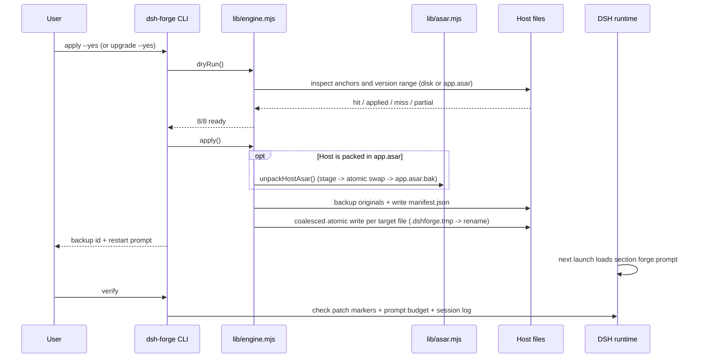
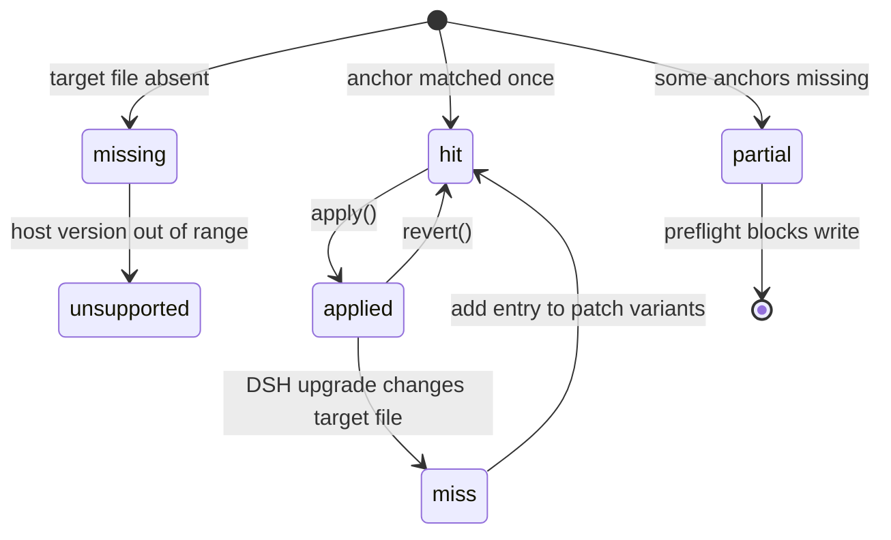
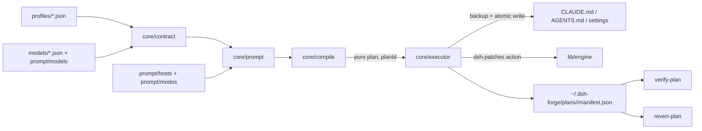

# Architecture

## 1. Module Layering and Directory Structure

`dsh-forge` is organized into two decoupled execution engines sharing a unified CLI and prompt corpus:

```
dsh-forge/
├── bin/
│   └── dsh-forge.js        # Unified CLI entry point (DSH native + cross-host commands)
├── core/                   # Host-neutral compiler & transactional executor
│   ├── contract.mjs        # Schema validation & loaders for profiles/*.json and models/*.json
│   ├── capabilities.mjs    # Capability matrix (prompt, approval, sandbox, tools, rollback) & preflight
│   ├── prompt.mjs          # Deterministic multi-layer prompt renderer & CJK-aware token estimator
│   ├── compile.mjs         # Pure compiler: (profile, model, mode) -> machine-independent plan
│   ├── executor.mjs        # Transactional writer (mergeBlock, mergeJson, mergeToml, backups, rollback)
│   ├── batch.mjs           # Multi-platform compile/apply, conflict checks, locks, and compensation rollback
│   ├── verify.mjs          # Internal plan hash check & post-apply target verification
│   ├── profile.mjs         # Public re-export facade for contract primitives
│   └── errors.mjs          # Structured ForgeError with stable machine-readable error codes
├── hosts/                  # Per-host environment detectors & configuration target descriptors
│   ├── adapter.mjs         # forge.host/v1 normalization and detection evidence
│   ├── registry.mjs        # Host catalog and adapter lookup (detectHost, detectAll, getAdapter)
│   └── *.mjs               # ten registered host adapters
├── profiles/               # Declarative target profiles (forge.profile/v1)
├── models/                 # Model family metadata & overlay bindings (forge.model/v1)
├── prompt/                 # Modular prompt sources
│   ├── core.md             # Base execution rubric (routing, boundary handling, A–D evidence grading)
│   ├── adapters/           # DSH runtime adapters (deepseek, generic)
│   ├── hosts/              # Per-host operational overlays
│   ├── models/             # Per-model-family behavioral overlays
│   └── modes/              # Task-specific overlays (coding, research, writing)
├── lib/                    # DSH-native runtime, ASAR unpacker, patch engine & Cordis plugin
│   ├── table.mjs           # 8 version-gated host patches (with per-version variants support)
│   ├── engine.mjs          # inspectPatch, dryRun, coalesced atomic apply, revert, upgrade
│   ├── asar.mjs            # Read-only app.asar header/file reader & atomic unpacker
│   ├── inject.mjs          # DSH prompt composition, budget check, session log proof verification
│   ├── doctor.mjs          # 12-point host, budget, conflict & bundle order inspection
│   ├── preset.mjs          # Workspace policy (strict/fallback/always) & profile bundle ordering
│   ├── paths.mjs           # Path resolution, path redaction & atomic file helpers
│   ├── log.mjs             # Daily JSONL event logger
│   └── index.js            # Cordis plugin entry, /forge slash command & loopback /dsh-forge/api
├── client/                 # DSH sidebar management UI
│   ├── src/entry.js        # Dependency-free React.createElement sidebar source
│   ├── client.js           # Built DSH module-loader bundle (generated by scripts/build-client.mjs)
│   └── preview/index.html  # Standalone static preview of the management panel
├── scripts/                # Build, profile verification, full verification & privacy scanner
├── tools/                  # Optional offline Python utilities (weight orthogonalization & refusal eval)
└── test/                   # Node.js built-in test suite (59 tests across 7 suites)
```

## 2. DSH Native Apply / Upgrade / Verify Sequence



## 3. Patch State Machine



## 4. Prompt Injection Pipeline

```
prompt/core.md       ─┐
prompt/adapters/*.md ─┼─▶ composePrompt() ─▶ checkBudget(3200) ─▶ section(forge:prompt, order 500/1000)
prompt/modes/*.md    ─┘        │
                               └─ <!-- dsh-forge vX.Y.Z sha256:... -->
```

The plugin registers a `systemPrompt` section (`forge:prompt`) through Cordis. If `~/.dsh/prompt-inject.md` was installed via `dsh-forge prompt install` (identified by the `<!-- dsh-forge ` header), the plugin reads that file so local edits take effect on next session start; otherwise it composes directly from `prompt/`. Section order is `1000` when overriding the workspace baseline (`strict`, or `fallback` with an active custom/workspace file) and `500` when coexisting (`always`).

## 5. Runtime State Locations

| Path | Purpose |
|---|---|
| `~/.dsh/dsh-forge/backups/<id>/manifest.json` | Host patch backup metadata (`hostVersion`, `forgeVersion`, file paths, `sha256`, `patchedSha256`) |
| `~/.dsh/dsh-forge/backups/<id>/files/NNNN-*` | Unmodified host files captured before `apply` |
| `~/.dsh/dsh-forge/unpacked-asar.json` | Unpack metadata (`size`, `mtimeMs`, `asarBackup`) when `app.asar` was unpacked |
| `~/.dsh/dsh-forge/preset.json` | Workspace policy (`strict`, `fallback`, or `always`) |
| `~/.dsh/dsh-forge/logs/forge-YYYYMMDD.jsonl` | Structured JSONL event log (`apply.done`, `revert.done`, `upgrade.done`, `apply.blocked`) |
| `~/.dsh/dsh-forge/reports/collect-*` | Redacted diagnostics archive generated by `dsh-forge collect` |
| `~/.dsh-forge/plans/<id>/manifest.json` | Cross-host transactional plan manifest (`beforeSha`, `afterSha`, per-file backups) |
| `forge.preview/v1` | Optional dry-run preview carrying target `beforeSha` values; `apply` refuses drifted files when the preview is supplied |

## 6. Cross-Host Compiler and Executor

The host registry is the platform boundary. `hosts/adapter.mjs` normalizes legacy host modules into `forge.host/v1`; `core/compile.mjs` consumes optional adapter hooks and otherwise falls back to the stable v1 target handlers. `core/batch.mjs` compiles and applies several platform plans with deterministic ordering, target conflict detection, one preview, a batch lock, and per-plan compensation rollback. DSH patching remains an adapter-owned provider; ordinary platform profiles do not load or invoke the DSH patch engine.



The compiler (`core/compile.mjs`) is pure: it validates `profile` and `model` schemas, resolves target paths within their declared scope, renders deterministic prompt bytes, and returns a machine-independent `planId`, action list, and token budget report without writing to disk.

The executor (`core/executor.mjs`) is the only layer that writes. It rejects symlinks during preflight, backs up every existing target file, writes via sibling temp file + atomic rename, records `beforeSha` and `afterSha`, and refuses to revert any file modified after apply unless `--force` is passed. Each file action writes an idempotent managed Markdown block, merges JSON keys, or updates top-level TOML keys before any `[table]` section while preserving existing user content.
